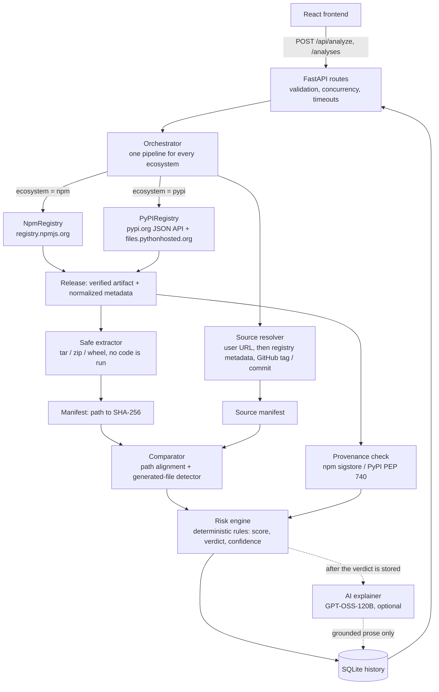

# TrustPack Backend

FastAPI service that answers one question for **npm** and **PyPI** packages: *does the artifact published to
the registry correspond to the source repository it claims to come from?* It downloads the release, resolves
the repository, compares every file by SHA-256, classifies the differences, reports provenance, and returns
an evidence-based verdict. An optional GPT-OSS-120B step explains the result in plain language.

The verdict is **deterministic**. The AI can explain it but cannot compute it, change it or add to it. A
package with no findings is reported as "no concerning differences identified by the implemented checks" —
never as "safe".

## Contents
1. [Architecture](#architecture)
2. [How an analysis works](#how-an-analysis-works)
3. [Risk model](#risk-model)
4. [Installation and running](#installation-and-running)
5. [Configuration](#configuration)
6. [GPT-OSS-120B setup](#gpt-oss-120b-setup)
7. [API](#api)
8. [Connecting the React frontend](#connecting-the-react-frontend)
9. [Testing](#testing)
10. [Security model](#security-model)
11. [Project structure](#project-structure)
12. [Known limitations](#known-limitations)

## Architecture



Everything between "Release" and "SQLite history" is shared by both ecosystems. A registry adapter's job
ends at *"here is the checksum-verified artifact and its metadata"* ([app/registries/base.py](app/registries/base.py)),
so npm and PyPI cannot drift apart in how files are hashed, compared or scored.

## How an analysis works

1. **Request.** The client sends `ecosystem`, `package_name`, an exact `version`, and optionally a GitHub
   `repository_url`. Names, versions and URLs are validated per ecosystem (SemVer / PEP 440, GitHub-only).
2. **Registry lookup.** Exact-version metadata is fetched (`registry.npmjs.org/{pkg}/{ver}` or
   `pypi.org/pypi/{pkg}/{ver}/json`). A document for a different package or version is rejected.
3. **Distribution choice.** npm has one tarball. For PyPI, TrustPack prefers the **sdist** (closest to the
   repository), then a pure-Python wheel, then another wheel; yanked or oversized files are skipped. The
   choice and the reason are returned as `distribution.selection_reason`.
4. **Checksum.** The artifact is downloaded with a hard size cap and verified against the registry's digest
   (npm SRI sha512 / legacy sha1, PyPI sha256). A mismatch stops the analysis with `HIGH_RISK`.
5. **Safe extraction.** Format is detected from magic bytes. Traversal, absolute paths, links, special files,
   duplicates, oversized or highly compressed entries and excessive counts are refused before any byte is
   written. Nothing is executed, built or imported.
6. **Registry-specific checks.** npm: lifecycle scripts (read from the *tarball's* `package.json`),
   registry-vs-tarball "manifest confusion", declared entry points. PyPI: executable `.pth` files,
   network/exec in `setup.py`, wheel `RECORD` hashes, embedded `METADATA` / `PKG-INFO` name and version.
7. **Source resolution.** Repository priority: the URL you supplied, then registry metadata (npm
   `repository`, PyPI project URLs), with the commit from npm `gitHead` or a version tag. Tags are matched
   *exactly* (GitHub's prefix matches are ignored). The result carries a confidence (`HIGH` exact commit,
   `MEDIUM` tag, `LOW` user-supplied different repo / homepage-derived / repository declares another
   version) and notes. If nothing can be established the report is `INCONCLUSIVE`, never guessed.
8. **Comparison.** Both trees are hashed with SHA-256. Wheel layouts (`pkg/x.py`) are aligned to repository
   layouts (`src/pkg/x.py`) only when several files agree. Each file becomes `IDENTICAL`, `ADDED`, `REMOVED`,
   `MODIFIED`, `UNEXPLAINED`, `EXPECTED_GENERATED` or `UNCERTAIN`. `package.json` is compared field by field,
   because npm rewrites it at publish time.
9. **Generated-file detection.** Location never earns trust. A differing file is `EXPECTED_GENERATED` only
   with evidence (see below); otherwise it is `UNCERTAIN` and counted against the verdict.
10. **Provenance.** npm sigstore attestations and PyPI PEP 740 attestations are cross-checked *at claims
    level* (digest, repository, commit). Signature chains are not verified, so the best possible status is
    `NOT_VERIFIED`.
11. **Verdict.** The risk engine produces level, score, verdict, confidence, findings and limitations, and
    the report is written to SQLite.
12. **Explanation (optional).** The stored report is projected onto a bounded JSON payload and sent to
    GPT-OSS-120B. The reply is validated, grounded in real finding ids and stored beside the report.

### Generated-file evidence

| Evidence | Weight | Examples |
|---|---|---|
| Strong | 2.0 | `src/a.ts` exists for `dist/a.js`; a source map whose `sources` resolve to repository files; a `.d.ts` with its `.ts`; standard wheel `*.dist-info` metadata; sdist `egg-info` / `PKG-INFO`; Cython `.c` with its `.pyx`; `_version.py` with `setuptools_scm` configured |
| Medium | 1.0 | declared in `main` / `module` / `types` / `exports` / `bin`; the repository has a build script **and** build tooling config |
| Weak | 0.5 | conventional directory (`dist/`, `build/`), `.min.js`, `.map`, `.d.ts` |

A total of **2.0 or more** is `EXPECTED_GENERATED`; 0.5-1.5 is `UNCERTAIN`; none is a normal added/modified file.
**Never trusted regardless of score:** executable files (unless a declared `bin`), script/binary extensions,
`.pth` files, and any file whose content looks obfuscated (`eval` over base64, dense hex escapes, shell
download-and-run, `marshal.loads`, reverse-shell code...). Compiled files (`.so`, `.node`, bytecode) are
always `UNCERTAIN`. A "generated" file is still scanned if it differs from the source.

## Risk model

Pure rules in [app/services/risk_engine.py](app/services/risk_engine.py), independent of the AI.

* **Score:** deduplicated findings weighted LOW 3 / MEDIUM 8 / HIGH 20 / CRITICAL 40, capped at 100.
* **Level:** `LOW` (<10), `MEDIUM` (>=10), `HIGH` (any HIGH finding or >=30), `CRITICAL` (>=60 or any CRITICAL),
  `INCONCLUSIVE` (no source correspondence and nothing severe). Failed checksum forces at least `HIGH`.
* **Verdict** (for the UI): `VERIFIED` / `WARNING` / `HIGH_RISK`. `VERIFIED` needs level `LOW`, a matched source,
  a verified checksum and **zero** uncertain files. Missing source, unverifiable checksum or any uncertain
  file is at best `WARNING`.
* **Confidence** (trust in the verdict, not riskiness): `HIGH` / `MEDIUM` / `LOW`, lowered by tag-only matches,
  low-confidence source, unverified checksum and uncertain files.
* **Missing evidence never raises the score** (no provenance, no tag); it lowers confidence and is listed in
  `limitations`.

Findings include added files absent from source, modified sensitive files (`setup.py`, `package.json`
scripts...), executables, install scripts, `.pth` code, obfuscated content, manifest confusion, wheel `RECORD`
mismatches, provenance claim mismatches and unverified generated files. Every finding has an `id`
(`finding-001`), `rule_id`, severity, confidence, evidence, explanation and recommendation.

## Installation and running

Requires Python 3.9+ (no newer syntax is used).

```bash
cd backend
python3 -m venv .venv                  # recreate it: a copied .venv has broken launcher scripts
source .venv/bin/activate
pip install -r requirements.txt
cp .env.example .env                   # loaded automatically; real environment variables win
python -m uvicorn app.main:app --reload --port 8000
```

* Swagger UI: http://127.0.0.1:8000/docs
* Health: `curl localhost:8000/health`
* Set `GITHUB_TOKEN` in `.env` for real use. Unauthenticated GitHub allows 60 API calls/hour; when it is
  exhausted TrustPack says so in `limitations` instead of claiming the tag does not exist.
* History is stored in `backend/data/trustpack.db` (SQLite, created on first use).

## Configuration

All settings are environment variables, documented with defaults in [.env.example](.env.example). The most
important ones:

| Variable | Default | Meaning |
|---|---|---|
| `GITHUB_TOKEN` | empty | raises the GitHub rate limit; used only for `api.github.com` |
| `ALLOWED_PYPI_HOSTS` | `pypi.org,files.pythonhosted.org` | the only hosts PyPI traffic may reach |
| `MAX_TARBALL_SIZE_BYTES` / `MAX_EXTRACTED_SIZE_BYTES` | 50 MiB / 200 MiB | download and extraction caps |
| `MAX_FILE_COUNT`, `MAX_COMPRESSION_RATIO` | 20000, 1000 | archive-bomb limits |
| `DATABASE_PATH` | `backend/data/trustpack.db` | analysis history |
| `REPORT_RETENTION_LIMIT` / `REPORT_TTL_SECONDS` | 1000 / 0 | pruning (0 = never expire by age) |
| `ANALYSIS_TIMEOUT_SECONDS` | 90 | budget for the deterministic analysis |
| `AI_ENABLED`, `AI_PROVIDER`, `AI_MODEL`, `AI_API_KEY`, `AI_BASE_URL`, `AI_TIMEOUT` | off / groq / `openai/gpt-oss-120b` / empty / empty / 60 | see below |
| `CORS_ORIGINS` | `localhost:3000,5173` | browser origins allowed to call the API |
| `SUPABASE_URL`, `SUPABASE_SERVICE_KEY` | empty / empty | shared analysis cache, see below |
| `CACHE_TTL_SECONDS`, `CACHE_ENGINE_VERSION` | 604800 (7 days) / `1` | cache freshness |

## Shared analysis cache (Supabase)

A package version is immutable once published, so a finished analysis of it is valid for everyone. With
this enabled, the first request for a given (ecosystem, package, version, repository) runs the full
download-and-compare analysis as usual and saves the result; every later request for that same version —
from any user or server instance — is served straight from the cache, skipping the registry download,
extraction and comparison entirely. The result carries `"cache": {"hit": true, ...}` (`fromCache: true` in
the frontend contract) so the UI can show it was cached.

1. Create a free project at [supabase.com](https://supabase.com).
2. In the SQL editor, run [supabase/schema.sql](supabase/schema.sql) to create the `analysis_cache` table.
   Row Level Security is enabled with no policies, so only the service-role key below can read or write it.
3. In `backend/.env`:
   ```env
   SUPABASE_URL=https://<project-ref>.supabase.co
   SUPABASE_SERVICE_KEY=<service_role key, from Project Settings → API>
   ```
4. Restart the server.

Without both variables set, the cache is simply off and every analysis runs fresh — nothing else changes.
Only a *complete* deterministic analysis is ever cached (a download failure, timeout or AI explanation is
never stored or served as if it were a hit). If `AI_ENABLED` is on and a cached entry doesn't have one yet,
an explanation is generated for it on that request and the cache is updated, without re-running the
analysis. Bump `CACHE_ENGINE_VERSION` after changing detection rules or scoring so old cached verdicts stop
being served; lower `CACHE_TTL_SECONDS` to re-check packages more often (e.g. in case a since-published
version was replaced on the registry).

## GPT-OSS-120B setup

AI is **off by default**; nothing leaves your machine until you enable it.

1. Create a key with a host that serves `openai/gpt-oss-120b` through an OpenAI-compatible API (Groq is the
   default; OpenRouter, Together, Fireworks and OpenAI-compatible servers also work).
2. In `backend/.env`:
   ```env
   AI_ENABLED=true
   AI_PROVIDER=groq
   AI_MODEL=openai/gpt-oss-120b
   AI_API_KEY=<your key>
   AI_TIMEOUT=60
   # AI_BASE_URL=            # optional override; https only (http allowed for localhost)
   ```
   For a self-hosted server (vLLM, Ollama...) set `AI_BASE_URL=http://localhost:8001/v1` and the model name it serves.
3. Restart the server. Reports now include `ai_explanation`:

```json
{
  "status": "ok",
  "provider": "groq", "model": "openai/gpt-oss-120b",
  "content": {
    "summary": "Short explanation of the analysis.",
    "key_findings": [{"file": "src/demo/_vendor.py", "explanation": "...", "severity": "high", "evidence_reference": "finding-005"}],
    "recommended_actions": ["Review the unexpected file."],
    "limitations": ["Source provenance could not be fully verified."]
  },
  "dropped_references": 0
}
```

`status` is one of `ok`, `disabled`, `unavailable` (no key, timeout, HTTP error) or `invalid_response`.

**Guarantees, enforced in code** ([app/services/ai_explainer.py](app/services/ai_explainer.py)):
the report and verdict are stored *before* the model is called; the model sees only a bounded projection
of the report (evidence strings truncated); its output must validate against a Pydantic schema; every key
finding must cite a real `finding-NNN` id, and its `file` and `severity` are overwritten with the
deterministic values (invented references are dropped and counted); package text is declared untrusted in the
prompt; the key is sent only in the `Authorization` header and never appears in reports, logs or errors; and
any failure leaves the analysis complete.

## API

Errors always look like `{"error": {"code": "...", "message": "..."}}` (validation errors add `details`).

| Method | Path | Purpose |
|---|---|---|
| GET | `/health` (`/api/health`) | liveness |
| POST | `/api/analyze` | run an analysis, returns the full report |
| GET | `/api/analysis/{id}` | fetch a stored report |
| GET | `/api/history?limit=50` | recent analyses, newest first |
| POST / GET | `/analyses`, `/analyses/{id}` | same data in the React frontend's camelCase shape |
| POST / GET | `/analyze`, `/report/{id}` | original paths, kept for compatibility |

Status codes: `200` ok, `404` package/version/report not found, `422` invalid request or unsupported
ecosystem, `429` upstream rate limit, `502` registry or download failure, `504` timeout.

```bash
# PyPI
curl -s -X POST localhost:8000/api/analyze -H 'Content-Type: application/json' \
  -d '{"package_name": "requests", "ecosystem": "pypi", "version": "2.32.3", "repository_url": null}' | python3 -m json.tool

# npm, with an explicit repository
curl -s -X POST localhost:8000/api/analyze -H 'Content-Type: application/json' \
  -d '{"package_name": "is-odd", "ecosystem": "npm", "version": "3.0.1", "repository_url": "https://github.com/jonschlinkert/is-odd"}'

curl -s localhost:8000/api/history | python3 -m json.tool
curl -s localhost:8000/api/analysis/<id>
```

`ecosystem` is `npm` (default) or `pypi` (case-insensitive). `repository_url` is optional and must be a
`github.com` URL. Abridged report:

```json
{
  "report_id": "…", "created_at": 1793472307.1,
  "package": {"name": "demo", "version": "1.0.0", "ecosystem": "pypi"},
  "source": {"repository": "https://github.com/acme/demo", "commit": null, "resolution_method": "tag",
             "correspondence": "INFERRED", "confidence": "MEDIUM", "notes": ["…"]},
  "distribution": {"kind": "sdist", "filename": "demo-1.0.0.tar.gz", "sha256": "…", "selection_reason": "…", "alternatives": []},
  "integrity": {"tarball_verified": true, "verification_algorithm": "sha256", "provenance_status": "NOT_AVAILABLE"},
  "summary": {"identical": 4, "modified": 0, "added": 1, "removed": 0, "expected_generated": 3, "uncertain": 0, "unexplained": 0},
  "risk": {"level": "HIGH", "score": 96, "verdict": "HIGH_RISK", "confidence": "MEDIUM", "rationale": ["…"]},
  "findings": [{"id": "finding-001", "rule_id": "PTH_FILE_EXECUTES_CODE", "file": "demo_hook.pth", "severity": "HIGH", "evidence": "…"}],
  "comparison": [{"path": "src/demo/core.py", "status": "UNEXPLAINED", "source_sha256": "…", "published_sha256": "…", "evidence": []}],
  "limitations": ["…"], "analysis_complete": true,
  "ai_explanation": {"status": "disabled"}
}
```

An offline demonstration with an honest and a tampered package: `python -m examples.demo_tampered`
(writes `examples/sample_pypi_tampered_report.json`).

## Connecting the React frontend

The frontend expects `/analyses` endpoints and camelCase data; the backend provides both. In the frontend's
`.env`:

```env
VITE_USE_MOCK=false
VITE_API_BASE_URL=http://localhost:8000
```

Run the backend on port 8000 and the frontend on 5173 or 3000 (both are in `CORS_ORIGINS`). Mapping notes:
`status` is the verdict in lower case; `signatureVerified` is always `false` because TrustPack never
verifies signature chains; `publishedAt` is the registry's upload time (PyPI) or the analysis time (npm,
whose version document has no publish time); the per-file `diff` text is not produced.

## Testing

```bash
cd backend
python -m pytest -q                     # whole suite, no internet needed
python -m pytest tests/test_pypi.py -v  # one area
```

All HTTP is mocked with `respx`, DNS is stubbed, and each test gets its own SQLite file with AI disabled, so
nothing touches the network, your history or a model provider. Coverage by file:

| File | Covers |
|---|---|
| `test_pypi.py` | distribution selection, sdist and wheel analysis, tampered packages, checksum mismatch, missing/wrong repository, version cross-check, PyPI provenance, not-found cases |
| `test_comparison.py` | npm added/removed/modified, legitimate generated files, payloads hidden in `dist/`, executables, `package.json` handling, manifest confusion, invalid and traversal archives, path alignment |
| `test_security.py` | tar and zip extraction attacks, bombs, permissions, URL rules, redirects, DNS pinning, response caps, temp-dir cleanup |
| `test_ai_explainer.py` | disabled / no key / timeout / HTTP error / invalid output, grounding, secret handling, verdict independence |
| `test_api_endpoints.py`, `test_api.py` | validation, history, retrieval, error codes, frontend contract |
| remaining files | the original npm pipeline, registry, downloader, provenance, risk and report tests |

The suite cannot cover live registries or live model output. The `AI_*` and GitHub paths against the real
services are verified only by mocked requests.

## Security model

Downloaded packages and repositories are untrusted input.

* **No code execution.** No `npm install`, `pip install`, `setup.py`, build step, import or subprocess. Source
  comes from GitHub archive downloads, so there is no `git` process either.
* **SSRF.** Every request and every redirect hop must be `https`, on the default port, without credentials, on
  an allow-listed host. Redirects are never followed automatically.
* **DNS rebinding.** Checking an address and then letting the HTTP client resolve the name again is racy. The
  client's network backend ([pinned_transport.py](app/utils/pinned_transport.py)) resolves once, rejects the
  connection if *any* address is private, loopback, link-local, multicast or reserved, and opens the socket to
  the validated IP while TLS still verifies the hostname. Environment proxies are ignored.
* **Resource limits.** Download, metadata (`MAX_METADATA_BYTES`), per-file, total, count, depth, path-length
  and compression-ratio limits; concurrency and time budgets. Oversized members are rejected from their
  header, before decompression.
* **Extraction.** No traversal, absolute or drive-letter paths, backslashes, symlinks, hardlinks, devices,
  duplicate or encrypted entries. setuid/setgid bits are dropped and archive ownership ignored.
* **Repository input.** Owner and repo names are restricted to GitHub's character sets, so they are safe to put
  in API URLs. Non-GitHub hosts and look-alike domains are rejected.
* **Cleanup.** Each analysis uses a private temp directory removed in a `finally` block, including on errors
  and cancellation.
* **Secrets.** `GITHUB_TOKEN` is sent only to GitHub; `AI_API_KEY` only to the AI endpoint, in a header.

## Project structure

```
backend/
  app/
    main.py, config.py          app, CORS, error handlers; env-driven settings (.env is loaded)
    api/routes.py               /api/*, frontend /analyses, legacy paths
    api/frontend_adapter.py     report -> React frontend shapes
    registries/                 base.py (contract), npm_registry.py, pypi_registry.py
    services/
      orchestrator.py           the single shared pipeline
      source_resolver.py        GitHub repo / commit / tag resolution with confidence
      archive_extractor.py      format detection + safe extraction
      manifest_generator.py     SHA-256 file manifests
      comparator.py             alignment + classification
      generated_file_detector.py  evidence-based build-output detection
      suspicious_code.py        obfuscation / hostile-code indicators
      normalizer.py             residual classification, package.json comparison
      metadata_analyzer.py      npm scripts, dependencies, code patterns
      provenance_checker.py     npm sigstore + PyPI PEP 740 claims checks
      risk_engine.py            findings -> score, level, verdict, confidence
      report_generator.py, report_store.py   report assembly + SQLite history
      ai_explainer.py           optional GPT-OSS explanation
    models/                     request / response schemas
    utils/                      security, http_client, pinned_transport, hashing, errors, logging
  tests/   examples/   requirements.txt   .env.example
```

## Known limitations

* **GitHub only.** GitLab, Bitbucket and self-hosted repositories are rejected, not guessed.
* **No rebuild.** Generated files are tied to the source by evidence (matching modules, source maps, build
  config), not reproduced. A malicious change inside a file that has a legitimate source counterpart and
  looks ordinary will not be detected by hashing; only the content indicators and a rebuild would.
* **Heuristic scanning.** Obfuscation and install-script checks are text patterns, not AST analysis or
  sandboxed execution, and can be evaded or can false-positive on legitimate bundles.
* **Tags are conventions.** A tag match is `INFERRED`, never `EXACT`. PyPI has no `gitHead`, so PyPI results
  are at best `MEDIUM` source confidence.
* **Wheels.** Compiled extensions (`.so`, `.pyd`) cannot be compared with source and are reported as uncertain,
  which caps the verdict at `WARNING`. Prefer packages that publish an sdist.
* **Not compared for PyPI:** declared dependencies and console-script entry points versus the repository.
* **Provenance is claims-level.** Sigstore certificate chains and transparency logs are not verified.
* **npm publish time** is not reported (the version document lacks it).
* **GitHub rate limits** apply without `GITHUB_TOKEN` (60 requests/hour).
* **Single process.** The concurrency limit and SQLite writer lock are per process; run one worker, or
  move history to a server database, before scaling out.
